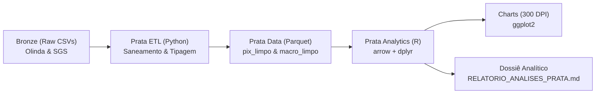
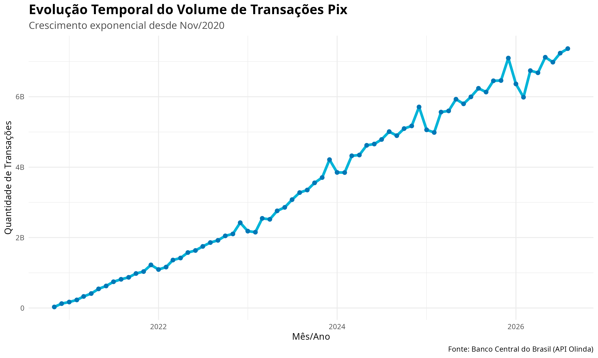
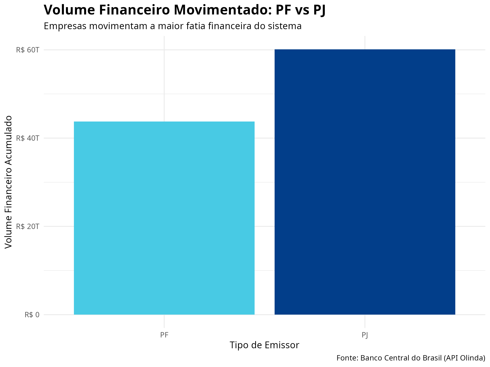
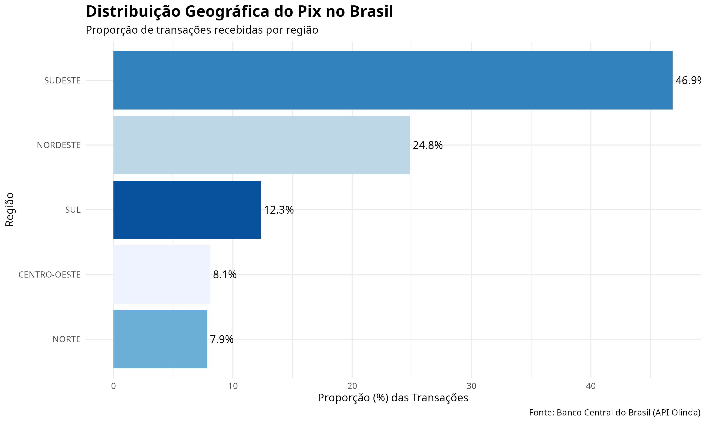
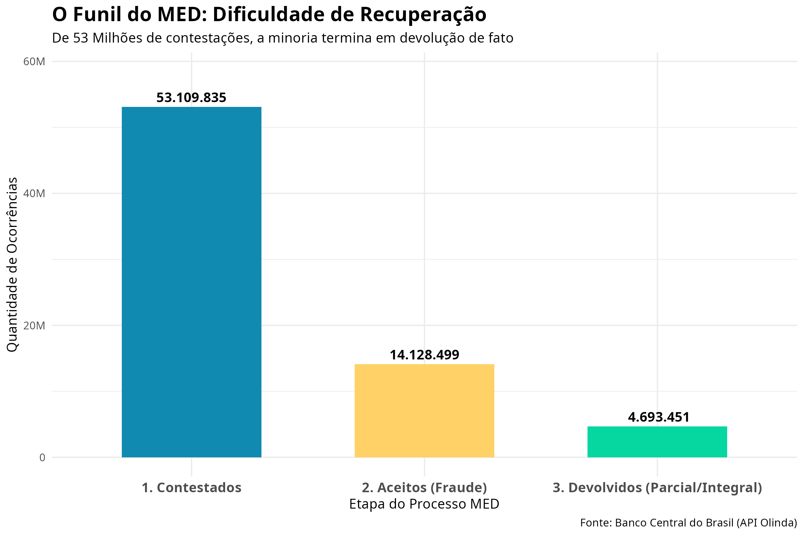
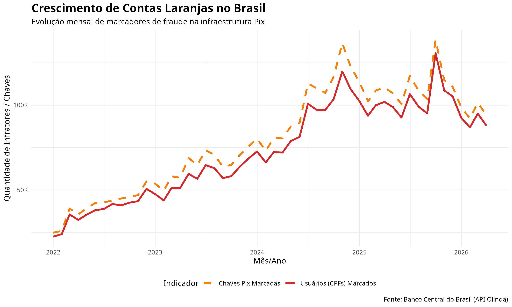

# Relatório Executivo de Análises: Camada Prata
**Projeto:** Engenharia de Dados e Economia Digital — Ecossistema Pix e Cenário Macroeconômico (Selic)  
**Ambiente:** Camada Prata (`prata/data/` e `prata/analytics/`)  
**Data da Análise:** Outubro de 2026  
**Mecanismos:** R (`arrow` + `dplyr` + `ggplot2`) e DuckDB sobre Apache Parquet

---

## 1. Visão Geral da Arquitetura Analítica

A Camada Prata consolidou os dados brutos da Camada Bronze em formatos analíticos colunares de alta performance (**Apache Parquet** com compressão Snappy e réplicas em **CSV**).

Com isso, a carga de Ciência de Dados e Visualização em Linguagem R passou a operar com tempo de resposta sub-segundo através do pacote `arrow`, permitindo extrair diagnósticos profundos antes da etapa de agregação dimensional na Camada Ouro.



---

## 2. Eixo 1: Dinâmica e Concentração Transacional do Pix

*Script de referência: [`01_analise_transacoes.R`](file:///home/gabriel/Documentos/UNIFEI/PERIODOS/DECIMO%20PERIODO/ENGENHARIA%20DE%20DADOS/Projetofinal/prata/analytics/r_scripts/01_analise_transacoes.R)*  
*Visualizações: [`pix_evolucao_temporal.png`](charts/pix_evolucao_temporal.png), [`pix_volume_pf_pj.png`](charts/pix_volume_pf_pj.png), [`pix_geografia.png`](charts/pix_geografia.png)*

### 2.1 Big Numbers do Sistema
* **Total de Operações Registradas:** **246.801.852.969** (~246,8 bilhões de transações).
* **Volume Financeiro Movimentado:** **R$ 103.899.105.638.136** (~R$ 103,9 trilhões de reais).
* **Granularidade da Base:** 741.383 buckets multidimensionais consolidados por demografia, região e natureza.



### 2.2 Assimetria de Perfis: Pessoa Física (PF) vs Pessoa Jurídica (PJ)

A análise revela uma forte assimetria comportamental entre os emissores de transações:

| Perfil Emissor | Quantidade de Transações | % do Volume | Volume Financeiro (R$) | % Financeiro | Ticket Médio Estimado |
| :--- | :---: | :---: | :---: | :---: | :---: |
| **Pessoa Física (PF)** | 216.953.815.843 | **87,91%** | R$ 43,80 trilhões | **42,16%** | **R$ 201,90** |
| **Pessoa Jurídica (PJ)** | 29.823.305.750 | **12,08%** | R$ 60,09 trilhões | **57,84%** | **R$ 2.015,20** |
| *Não Disponível* | 24.731.376 | 0,01% | R$ 3,39 bilhões | <0,01% | R$ 137,00 |



> [!NOTE]
> **Diagnóstico Econômico:**
> Enquanto os indivíduos (PF) utilizam o Pix predominantemente para **micropagamentos e compras de varejo diário** (compras em mercados, transferências peer-to-peer e substituição de dinheiro físico), as empresas (PJ) adotaram o Pix como **mecanismo de compensação de tesouraria de alto valor** (pagamento a fornecedores e liquidações B2B), superando o valor total movimentado pelos indivíduos em mais de R$ 16 trilhões.

### 2.3 Penetração Geográfica e Desigualdade Regional

A distribuição de transações por região recebedora reflete a concentração de renda e bancarização do país:

| Região Recebedora | Transações Recebidas | Proporção (%) | Papel Econômico Identificado |
| :--- | :---: | :---: | :--- |
| **Sudeste** | 115.584.912.037 | **46,85%** | Centro financeiro e comercial do país. |
| **Nordeste** | 61.242.121.809 | **24,82%** | Forte inclusão bancária em municípios do interior. |
| **Sul** | 30.417.095.212 | **12,33%** | Alta densidade de transações per capita. |
| **Centro-Oeste** | 20.032.263.838 | **8,12%** | Liquidação impulsionada pelo agronegócio. |
| **Norte** | 19.403.563.150 | **7,86%** | Crescimento acelerado com redução do isolamento bancário. |
| *Não Informado* | 121.896.923 | 0,05% | Operações interestaduais não roteadas. |



---

## 3. Eixo 2: Auditoria de Segurança e o Mecanismo Especial de Devolução (MED)

*Script de referência: [`02_analise_fraudes.R`](file:///home/gabriel/Documentos/UNIFEI/PERIODOS/DECIMO%20PERIODO/ENGENHARIA%20DE%20DADOS/Projetofinal/prata/analytics/r_scripts/02_analise_fraudes.R)*  
*Visualizações: [`fraudes_funil_med.png`](charts/fraudes_funil_med.png), [`fraudes_contas_laranjas.png`](charts/fraudes_contas_laranjas.png)*

### 3.1 O Funil da Fraude e o Gargalo de Recuperação

O dataset de fraudes contabilizou 52 meses de histórico do Mecanismo Especial de Devolução (MED), revelando a discrepância entre contestações e ressarcimento real:

```
[53.109.835 Pix Contestados]
        │
        ▼ (26,60% aceitos como fraude)
[14.128.499 Fraudes Confirmadas]
        │
        ├──────────────────────┬──────────────────────┐
        ▼                      ▼                      ▼
[2.293.170 Devolvidos]  [2.400.281 Devolvidos]  [8.760.713 NÃO Devolvidos]
     (Integral)             (Parcial)              (62,01% PERDA TOTAL)
```



> [!WARNING]
> **O Gargalo da Dispersão Financeira:**
> Em **62% das fraudes aceitas**, o Banco Central e os bancos liquidantes não conseguem recuperar nenhum centavo (`qtd_nao_devolvida_saldo_insuficiente` e `qtd_nao_devolvida_conta_encerrada`). Os fraudadores utilizam redes de transferências imediatas para pulverizar os valores em múltiplas contas ou converter em criptoativos minutos após o golpe, neutralizando a eficácia do bloqueio cautelar.

### 3.2 Infraestrutura de Contas Laranjas e Chaves Criminosas

* **Média Mensal de Usuários com Marcação de Fraude:** **73.071 CPFs/CNPJs** identificados no DICT.
* **Média Mensal de Chaves Pix Marcadas:** **80.323 chaves**.
* **Razão Chave/Usuário:** **~1,10**, indicando que as organizações criminosas cadastram múltiplas chaves (e-mails descartáveis, telefones VoIP e chaves aleatórias) em contas de laranjas para garantir a rotação contínua de canais de entrada.



---

## 4. Eixo 3: Contexto Macroeconômico e o Sistema Selic

*Script de referência: [`05_analise_selic.R`](file:///home/gabriel/Documentos/UNIFEI/PERIODOS/DECIMO%20PERIODO/ENGENHARIA%20DE%20DADOS/Projetofinal/prata/analytics/r_scripts/05_analise_selic.R)*  
*Tabelas Prata: [`taxa_selic_mensal.parquet`](file:///home/gabriel/Documentos/UNIFEI/PERIODOS/DECIMO%20PERIODO/ENGENHARIA%20DE%20DADOS/Projetofinal/prata/data/macro_limpo/taxa_selic_mensal.parquet) e [`operacoes_selic.parquet`](file:///home/gabriel/Documentos/UNIFEI/PERIODOS/DECIMO%20PERIODO/ENGENHARIA%20DE%20DADOS/Projetofinal/prata/data/macro_limpo/operacoes_selic.parquet)*

### 4.1 O Ciclo da Taxa de Juros (Selic Meta vs Selic Realizada)

A análise histórica de 83 meses (de 2020 a 2026) sintetiza o ciclo monetário brasileiro no período de existência do Pix:

* **Mínima Histórica:** **2,00% a.a.** (Agosto/2020 — auge do estímulo emergencial pós-COVID).
* **Pico do Ciclo:** **15,00% a.a.** (Junho/2025 — ciclo de aperto para ancoragem de expectativas).
* **Taxa Selic Média do Período:** **10,38% a.a.**

| Marco Temporal | Ano-Mês | Selic Meta Fim de Mês | Selic Realizada Média Mês | Dias Úteis |
| :--- | :---: | :---: | :---: | :---: |
| **Lançamento do Pix** | 2020-11 | 2,00% | 1,90% | 20 |
| **Início do Aperto Monetário** | 2021-11 | 7,75% | 7,65% | 20 |
| **Maturidade e Consolidação** | 2024-01 | 11,75% | 11,65% | 22 |

> [!IMPORTANT]
> **Achado Macroeconômico (Inelasticidade da Adoção do Pix):**
> O lançamento do Pix ocorreu em um momento de juro real negativo (Selic em 2%), estimulando a adoção de contas digitais remuneradas e bancos digitais. Contudo, a subida drástica da Selic para patamares de dois dígitos **não desacelerou a curva de adoção do Pix**. Isso demonstra que o Pix é um **bem público de infraestrutura inelástico**, cuja adesão decorre de ganho de eficiência transacional e conveniência, e não de incentivos puramente financeiros.

### 4.2 Mercado de Títulos Públicos (Operações no Selic)

A análise consolidada dos 82 meses da API Olinda (`operacoes_selic.parquet`) totalizou **2.978 registros mensais categorizados**. As maiores linhas de liquidez do sistema interbancário nacional são:

| Categoria da Operação | Quantidade Total de Operações | Volume Total Acumulado (R$ Milhões) | Giro Financeiro Estimado |
| :--- | :---: | :---: | :--- |
| **Recompra / Revenda** | 16.645.847 | **R$ 4.725.481.492** | ~R$ 4,72 quatrilhões |
| **Compromissada** | 16.606.871 | **R$ 4.724.938.930** | ~R$ 4,72 quatrilhões |
| **Redesconto** | 2.265.978 | **R$ 495.365.887** | ~R$ 495,3 trilhões |
| **Pagamento de Redesconto** | 2.121.871 | **R$ 495.341.934** | ~R$ 495,3 trilhões |
| **Compra/Venda Definitiva** | 10.609.589 | **R$ 163.996.467** | ~R$ 163,9 trilhões |

As operações de mercado aberto e compromissadas ancoram o sistema financeiro nacional e operam como o lastro diário de liquidez sob o qual todo o ecossistema de pagamentos instantâneos (Pix) se apoia.

---

## 5. Diretrizes para a Camada Ouro

Com a base limpa e diagnosticada na Camada Prata, as seguintes regras de cruzamento devem ser seguidas na Camada Ouro:

1. **Chave Primária de Cruzamento:** A coluna `ano_mes_dt` (formato `DATE` no 1º dia do mês, ex: `2020-11-01`) ou `ano_mes` (inteiro `YYYYMM`) é a chave canônica entre todas as tabelas mensais:
   * `estatisticas_transacoes_pix`
   * `estatisticas_fraudes_pix`
   * `taxa_selic_mensal`
   * `operacoes_selic`
2. **Evitar Explosão Cartesiana:** As tabelas de Fraudes e de Selic são estritamente mensais (1 linha por mês). As Transações Pix contêm múltiplos buckets por mês (cerca de 10.000 a 14.000 linhas por mês). Qualquer agregação deve ocorrer previamente antes do `JOIN`, ou os dados mensais devem ser mantidos como dimensões temporais associadas via modelo estrela (*Star Schema*).
3. **KPIs Definidos para Dashboards:**
   * **Custo Brasil da Fraude:** `(valor_pix_contestados_aceitos - valor_devolvido_integral_med - valor_devolvido_parcial_med)`.
   * **Taxa de Efetividade do MED:** `(qtd_devolvida_integral_med + qtd_devolvida_parcial_med) / qtd_contestacoes_aceitas`.
   * **Taxa de Penetração PJ vs PF:** Razão de volume e ticket médio mensal.
