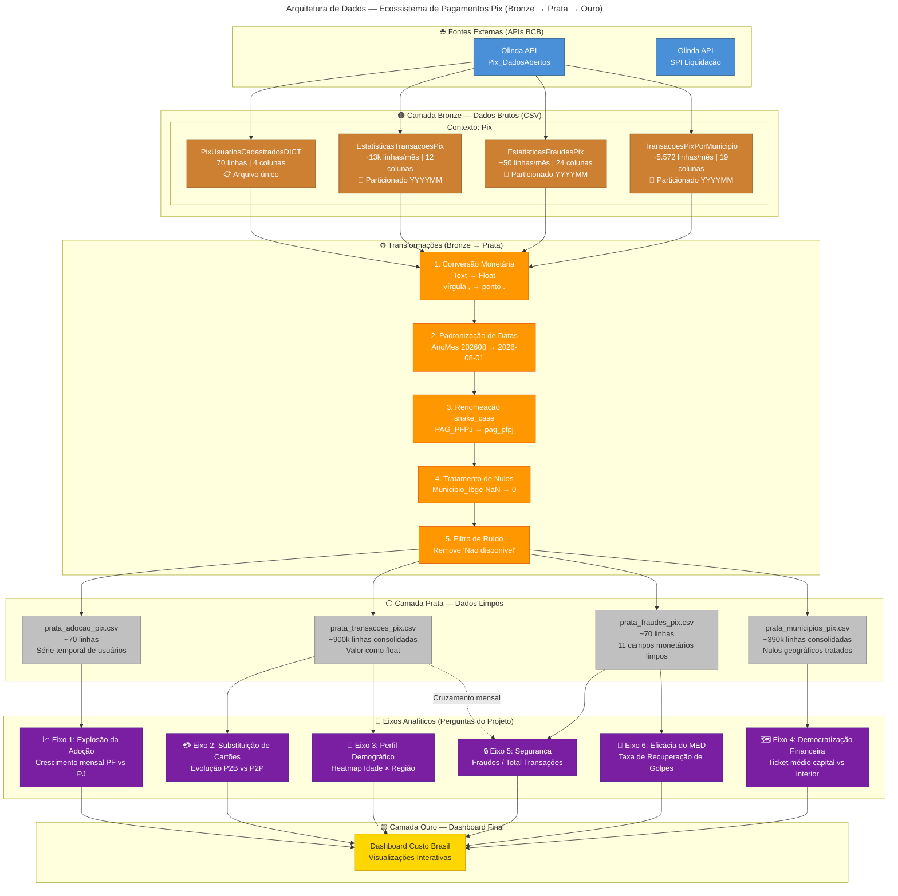

---

## Diagrama de Relacionamento entre Tabelas (Modelo Lógico da Prata)

```mermaid
erDiagram
    PRATA_ADOCAO_PIX {
        date data_referencia PK
        int qtd_usuarios_pf
        int qtd_usuarios_pj
        int qtd_usuarios_total
    }

    PRATA_TRANSACOES_PIX {
        date data_referencia PK
        string pag_pfpj
        string rec_pfpj
        string pag_regiao
        string rec_regiao
        string pag_idade
        string rec_idade
        string forma_iniciacao
        string natureza
        string finalidade
        float valor
        int quantidade
    }

    PRATA_FRAUDES_PIX {
        date data_referencia PK
        int qtde_pix_contestados
        int qtde_contestacoes_aceitas
        int qtde_contestacoes_rejeitadas
        float taxa_contestacoes_100mil
        int qtde_usuarios_marcados_fraude
        int qtde_chaves_marcadas_fraude
        float valor_contestados_aceitos
        int qtde_devolvida_integral_med
        float valor_devolvidos_integralmente
        int qtde_devolvida_parcial_med
        float valor_devolvidos_parcialmente
        float valor_residual_nao_devolvido
        float percentual_devolucao
    }

    PRATA_MUNICIPIOS_PIX {
        date data_referencia PK
        int municipio_ibge PK
        string municipio
        int estado_ibge
        string estado
        string sigla_regiao
        string regiao
        float vl_pagador_pf
        int qt_pagador_pf
        float vl_pagador_pj
        int qt_pagador_pj
        float vl_recebedor_pf
        int qt_recebedor_pf
        float vl_recebedor_pj
        int qt_recebedor_pj
        int qt_pes_pagador_pf
        int qt_pes_pagador_pj
        int qt_pes_recebedor_pf
        int qt_pes_recebedor_pj
    }

    PRATA_ADOCAO_PIX ||--o{ PRATA_TRANSACOES_PIX : "data_referencia"
    PRATA_ADOCAO_PIX ||--o{ PRATA_FRAUDES_PIX : "data_referencia"
    PRATA_ADOCAO_PIX ||--o{ PRATA_MUNICIPIOS_PIX : "data_referencia"
    PRATA_TRANSACOES_PIX }o--|| PRATA_FRAUDES_PIX : "data_referencia"
